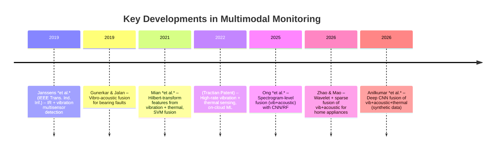

# Multimodal Machine Health Monitoring (Thermal, Vibration, Acoustic)

**Executive Summary:** Recent research increasingly combines vibration, thermal-imaging, and acoustic (sound) sensing for fault detection in machinery.  Studies report that fusing data from these modalities—often via deep learning or feature-level fusion—can dramatically improve detection accuracy versus single-sensor approaches. For example, Janssens et al. (2019) showed that combining infrared and vibration data yields more accurate fault detection in rotating machinery than either alone. Likewise, Gunerkar & Jalan (2019) fused accelerometer and acoustic‐emission signals to diagnose bearing faults, finding that acoustic sensors were especially effective for certain defect types. Recent work also uses convolutional neural networks (CNNs) or attention-based models to fuse spectrograms or raw signals from multiple sensors, achieving high classification accuracy (often 90–99% on test data). Patents describe similar multimodal approaches: for instance, a Chinese patent (CN120846426A) integrates vibration, acoustic, and thermal camera data through multi-stage fusion and an LSTM-based classifier. Despite promising results, most academic studies use laboratory rigs or synthetic datasets; public benchmarks for tri-modal monitoring remain scarce. Common best practices include using 1/3-octave or octave-band analyses for sound, extracting time- and frequency-domain features (FFT peaks, RMS, kurtosis, MFCCs, etc.), and employing adaptive fusion weights or deep learning for reliability. Key limitations are environmental noise sensitivity, sensor placement dependence, and computational complexity. 

We compile the following comprehensive review:

## 1. Survey of Multimodal Monitoring Techniques 

Recent papers (2016–2026) have explored various combinations of **vibration**, **acoustic**, and **thermal** sensing for condition monitoring. Table 1 summarizes key studies and patents with their methods:

| Source / Year                     | Type        | Asset/Machine        | Sensors Used             | Features / Processing                | Fusion Method        | ML Model            | Data/Evaluation             | Results (Accuracy/Metrics)           |
|-----------------------------------|-------------|----------------------|--------------------------|--------------------------------------|----------------------|----------------------|-----------------------------|--------------------------------------|
| Anilkumar et al. (2026) | Journal (Synthetic Study) | Generic rotating machinery (bearing/pump) | Accelerometer (vib), Microphone, IR camera | Raw signals → 1D CNN (vib/acoustic) + 2D CNN (thermal image) embeddings | Intermediate (softmax-weighted) fusion | CNN (multibranch) | Synthetic 4-class dataset (1200 samples: healthy, bearing fault, misalign, overheating) | 99.44% accuracy (macro-F1=0.9944) (unimodal baselines: vib 76.1%, acoustic 88.9%, thermal 54.4%) |
| Janssens et al. (2019) | IEEE TII | Rotating machinery (motors, gearboxes) | IR thermal camera + vibration sensor | Features from vibration and thermography (not detailed) | Multisensor fusion (method unspecified) | Likely classical or ML (paper focused on concept) | Laboratory test rigs (4 fault types) | Combining IR+vib yielded better fault detection than either alone (quant. not given) |
| Mian et al. (2021) | IMechE Proc. O | Rotating machine (bearings) | Contact accelerometer + thermal imaging camera | Hilbert transform on signals; extract statistical features (not specified) | Feature-level concatenation with NCA+Relief selection | SVM classifier | Experimental bearing data (healthy vs. faults) | “Considerably improved classification accuracy” vs. single sensor (no % given) |
| Gunerkar & Jalan (2019) | *Exp. Techniques* | Rotating ball bearings | Vibration (accelerometer) + Acoustic‐emission (AE) sensor | Time-domain signal indicators (RMS, kurtosis, AE hits, etc.) | Decision-level (classifier outputs fused) | k-NN classifier | Lab test bearings (inner/outer race, ball faults) | Multi-sensor approach detected all fault types early (vib sensed inner/outer, AE sensed ball faults) (qualitative) |
| Ong et al. (2025) | ArXiv/Conference (accepted) | Rotating bearings | Vibration + Acoustic microphones | STFT spectrograms (features: CNN and RF inputs) | Feature-level (concatenated spectrogram features) | CNN, Random Forest, SVM | 450 samples, 5 classes (healthy, cage, ball, inner, outer) | Multi-sensor fusion beats single-sensor: +5.68% (CNN), +10.11% (RF), +3.33% (SVM) improvement |
| Zhao & Mao (2026) | *Sensors & Materials* | Home appliances (washer, AC, refrigerator) | Accelerometer + MEMS microphone | Wavelet decomposition; extract energy, moments (mean, std, kurtosis); sparse coding | Adaptive feature-level fusion (Fisher criterion weights) + sparse representation | Nearest-library matching (fault library) | Lab faults on appliances | Accuracy boosted 15–25% vs. static fusion; recognition >85% even at –5 dB SNR |
| CN120846426A (2022) | Patent | Circuit breaker mechanism | Vibration sensor + Acoustic (ultrasonic) + Thermal camera + Current + Displacement | Wavelet denoising, EMD, time-frequency; extract entropy, MFCC, temperature stats, etc. | Multi-level fusion: data-layer (signal fusion), feature-layer (autoencoder for reduction), decision-layer (LSTM+attention) | LSTM with attention; Evidence-theory rule fusion | Described method (no public data) | Aim: “greatly improved accuracy” and early warning, with confidence via expert rules |
| US20260194924A1 (2026) | Patent App. | Unmanned aerial vehicle | Microphones + Vibration sensors (accelerometers) + Pressure + Thermal cameras | On-board capture; presumably extract spectral/time features | Data fusion via on-board microcontroller; real-time ML | TinyML/embedded ML (unspecified) | Not applicable (conceptual) | Claims real-time alerts; fuses acoustic, vibration, pressure, thermal for UAV faults |
| US9244042B2 (2016) | Patent | Turbomachinery, gas turbines, etc. | Microphone (audio) + Vibration accelerometers | Audio samples processed into “acoustic fingerprints”; vibration signals | Data transmission to cloud; analytics (FFT, features) | “Cloud” analytics (GE System 1 style) | Field machinery | Describes capturing audio and vibration for diagnostics; improves early fault detection |
| Tractian (2022) | Industry Blog (patent) | Generic rotating equipment | High-rate accelerometer (32 kHz) + Temperature sensor | On-device ML compression of FFT/motion “fingerprint” | Proprietary sensor + cloud analytics | ML on reconstructed vibration patterns | Field deployments (250,000 machines) | Claims precise fault-mode detection and actionable diagnostics (no published metrics) |

*Table 1: Key multimodal monitoring sources.* (Citations listed as. “Data/Evaluation” indicates dataset or test context; “Results” notes reported performance or claims.)

Most studies extract a mix of **time-domain** (RMS, skewness, kurtosis, crest factor, entropy, etc.) and **frequency-domain** (FFT peaks, envelope spectrum, spectral bands) features from each sensor.  For acoustic data, common features include **1/3-octave** or **octave-band energies**, **MFCCs** (Mel-frequency cepstral coefficients), or **spectrogram** coefficients. Vibration features often include FFT spectrum amplitudes at fault frequencies, envelope analysis, and statistical moments. Thermal images are analyzed either by extracting temperature statistics (max, gradient) or by feeding raw/segmented thermal maps into a CNN.

**Octave-band analysis:**  A widely-used acoustic feature method is to aggregate signal energy into standardized octave (or one-third-octave) frequency bands. Each octave band doubles in frequency range (e.g. 1 kHz–2 kHz). This approach simplifies complex spectra into logarithmically spaced bands (Figure below) and is recommended by some predictive-maintenance systems. By trending band energy over time, maintenance engineers can track the emergence of vibrations in specific ranges, potentially diagnosing issues like imbalance or looseness.

 *Figure: Octave and 1/3-octave frequency bands partition the spectrum into logarithmic ranges.  This band-based analysis is often used in vibration/acoustic monitoring to simplify spectral information. (Image: Commercial Acoustics, reproduced under fair use.)*

**Feature fusion:** Fusion strategies vary. Many papers use *feature-level* fusion (concatenating or weighting features from each sensor). For example, Mian et al. simply concatenate vibration and thermal features and then use PCA/NCA for reduction. Others apply *decision-level* fusion, where each modality yields a classification and the outputs are combined (e.g. voting). Some use *intermediate fusion* with neural networks: Anilkumar et al. use parallel CNN branches for each modality, then fuse via learned attention weights. Zhao & Mao propose an adaptive scheme that dynamically weights acoustic vs. vibration features based on operating state (using a Fisher discriminant criterion). In industry, the Chinese circuit-breaker patent describes a three-layer fusion (raw data fusion, feature fusion via autoencoder, and decision fusion via evidence theory).  

Common **machine learning models** include SVMs (e.g. Mian et al. using SVM), CNNs (Anilkumar’s 1D/2D CNN, Ong’s CNN on spectrograms), k-NN (Gunerkar’s work), and ensemble methods (random forests, deep sparse representations). Some use LSTM or attention-based networks for sequence fusion (as in the CN patent). Reported metrics are often accuracy or F1-score on test sets. For example, Anilkumar et al. report ~99.4% accuracy, and Ong et al. report multi-sensor accuracy improvements on the order of 3–10%.

## 2. Best Practices and Limitations

**Best Practices:**  To maximize detection, studies recommend deploying *multiple sensor types* that capture complementary physics. Vibration sensors excel at resonance and mechanical defects, whereas acoustic/microphone sensors can pick up airborne high-frequency defects that vibration might miss. Thermal cameras detect heat signatures from friction or electrical issues. Using **standardized features** improves robustness: e.g., octave-band energy, MFCCs for sound (familiar in noise monitoring), and statistical or kurtosis features for vibration.  Combining time- and frequency-domain features tends to help classifiers (e.g. extracting both FFT peaks and RMS/kurtosis from each signal).

For **fusion**, adaptive weighting or reliability gating helps. In practice, environmental noise or sensor malfunctions can degrade some modalities. Techniques like the “reliability gate” in Anilkumar’s model or Zhao’s adaptive Fisher fusion ensure that weak/noisy sensors are down-weighted. Many systems perform local preprocessing (denoising, band-pass filters) on the edge before fusion to reduce noise.

**Limitations:** A key gap is *validation on real-world data*. Most papers use controlled lab setups or synthetic data. For example, Anilkumar’s excellent results come from a synthetic benchmark. Widely-published public datasets for simultaneous vib+acoustic+thermal monitoring are virtually nonexistent. Thus, claimed accuracies may not generalize. Environmental factors (ambient noise, changing temperature) are underexplored. Moreover, sensor placement, calibration, and data synchronization (especially for high-speed vibration vs. slower thermal sampling) pose challenges. Octave analysis simplifies spectra but loses spectral detail, so it may miss subtle faults. Deep-learning approaches require substantial training data and computational resources, raising deployment cost and time. 

**Gaps for Research:** Open questions include how to fuse extremely heterogeneous data (e.g. point temperature from a spot IR vs. full thermal image vs. vibration time series), how to do *multimodal transfer learning* across machines, and how to perform *self-supervised* learning given lack of labels. Also, dynamic fusion architectures that handle missing modalities are needed (e.g. if an IR camera fails, fall back gracefully). Finally, few studies address *online* or *embedded* implementations; bridging edge computing with cloud ML is an active area.

## 3. Representative Patents

Patents often describe comprehensive systems. Representative examples:

- **CN120846426A (2022):** Describes a *multi-modal monitoring system* for circuit breakers. It simultaneously collects vibration, acoustic (ultrasonic and audible sound), infrared thermal images, coil current, and displacement data. Signals are preprocessed (wavelet denoising, empirical mode decomposition) and features extracted (e.g. energy entropy from vib, MFCCs and octave-band energies from sound, max/avg temperature and texture from IR). A hierarchical fusion model is used: **data layer** fuses signals (e.g. weighted average), **feature layer** concatenates and reduces via a sparse autoencoder, and **decision layer** runs a pre-trained deep LSTM (with attention) on the fused features. Finally, an expert-knowledge rule base (evidence theory) fuses the LSTM outputs into a fault decision. The patent claims this multi-level fusion “greatly improve[s] accuracy” and provides early-warning with a confidence score.

- **US20260194924A1 (2026):** A UAV monitoring system that fuses **microphone, accelerometer, pressure, and thermal camera** data on-board. All sensors feed into an on-board microcontroller running ML models (TinyML). For example, real-time acoustic and vibration anomalies trigger alerts, and thermal imagery detects overheating. The system can command the UAV to adjust its flight on fault detection. This patent focuses on *embedded multi-modal sensing* with on-board analysis for drones.

- **US9244042B2 (2016):** This GE patent covers a *vibration and audio* detection system for turbomachinery. It envisions a detection device that can capture **audio samples and/or vibration signals** (e.g. via accelerometers, microphones, even smartphones) from machinery. These are sent to a cloud/analytics platform (e.g. GE’s software) where they are processed (e.g. generating acoustic fingerprints). The patent primarily claims the methods for capturing both sound and vibration data together to improve fault detection accuracy.

- **Tractian (US20220000001, 2022):** Tractian’s (Brazilian startup) patent, announced in 2022, covers a high-frequency (32 kHz) vibration sensor with integrated temperature monitoring. The sensor streams compressed vibration spectra and temperature to a remote ML engine. A patented algorithm reconstructs the vibration “fingerprint” and applies a machine-learned model to predict specific faults. Notably, Tractian claims its system uniquely identifies fault *modes* (e.g. “bearing inner race crack”) and suggests fixes, rather than just issuing generic alerts.

These patents implement multi-modal fusion via various architectures: hierarchical (CN patent), parallel ML pipelines (UAV), or simply correlated data streams (GE, Tractian). Common claimed inventions include advanced feature extraction (MFCCs, EMD, wavelets), hybrid fusion (neural networks + rule-based systems), and real-time on-board processing.

## 4. System Design Blueprint

A practical multimodal monitoring system might be structured as follows:

```mermaid
graph LR
  subgraph Sensors
    A[Vibration: Accelerometer] 
    B[Acoustic: Microphone] 
    C[Thermal: IR Camera] 
  end
  Sensors -- capture signals --> D[Edge Preprocessor]
  D -->|extract features / filter noise| E[Feature Fusion Module]
  E --> F[Machine Learning Model (e.g., CNN/LSTM)]
  F --> G[Fault Diagnosis Output]
  G --> H[Cloud Dashboard / Alert System]
  style D fill:#f9f,stroke:#333,stroke-width:1px
  style E fill:#bf9,stroke:#333,stroke-width:1px
  style F fill:#9df,stroke:#333,stroke-width:1px
```

**Sensors:** Use rugged tri-axial accelerometers for vibration, precision MEMS or condenser microphones for acoustics (or dedicated AE sensors for ultrasonic), and a calibrated thermal camera (radiometric IR) for heat patterns. Sensor models could include IEPE accelerometers (e.g. PCB Piezotronics), MEMS mics (Knowles), and IR cameras (FLIR Lepton or Teledyne FLIR). 

**Sampling:** Accelerometers typically sample at 8–50 kHz to capture high-frequency vibration. Acoustic sensors can sample at similar rates (16–48 kHz) for audible+ultrasound. Thermal cameras frame rates are lower (e.g. 1–30 Hz), so one can treat thermal data as a slowly-updated image stream. Ensure all data are time-synchronized (timestamping or hardware sync) if fusing raw signals. 

**Edge vs. Cloud:** Basic preprocessing (anti-aliasing filters, windowing) and feature extraction (FFT, band-pass filters, octave-band energy computation) should run on an edge device (industrial gateway or embedded processor) to reduce data volume. For example, compute RMS and band energies on-site, and send compressed representations (or ML inference results) to the cloud. Critical fusion (e.g. a neural network) can run either on an edge GPU or in the cloud, depending on latency/power budgets. Hybrid approaches (edge feature fusion + cloud classification) are common.

**Feature Set:** Collect multi-domain features: e.g. time-series statistics (RMS, variance, crest factor) and frequency features (FFT peaks, envelope spectrum, octave-band levels) from vibration; octave-band energy, MFCCs, spectral centroids from acoustic sound; and temperature-based features (max temp, gradient, thermal histogram) from IR images. Possibly also spatial features (image zones of hot spots) using CNNs. Fusion inputs could be raw spectrogram images, deep embeddings, or concatenated feature vectors.

**Fusion Approach:** Early/feature-level fusion (concatenate all features) is simple to implement and often effective. Adaptive or weighted fusion (adjusting each modality’s influence) improves robustness. Architecturally, one can use a multi-branch CNN/LSTM that processes each modality separately and merges features in later layers (mid-level fusion). For decision-level fusion, separate classifiers (e.g. SVMs) can each vote or input to a voting ensemble.

**Training/Labeling:** Begin with labeled fault data from controlled tests or historical records. If labels are scarce, consider data augmentation (adding noise, simulating faults) or semi-supervised learning. Retrain models periodically using new fault occurrences to improve adaptation (as Tractian’s patent suggests). An active-learning pipeline (engineer validation loops) can help refine decisions.

**Deployment & Maintenance:** Provide real-time alerts and a dashboard showing sensor trends (vib spectrum, sound levels, thermal maps). Update ML models via cloud when new data or fault modes are available. Regularly calibrate sensors (especially IR cameras) and check microphone placement (acoustic paths) for consistency.

**Cost and Risks:** 
- *Low cost:* A simple vib+mic setup with a small single-board computer running fixed thresholds or SVMs. May miss subtle faults.
- *Medium:* Add thermal camera and use embedded deep learning for fusion. Good performance but higher hardware expense.
- *High:*  Full suite (3-axis vib, broadband mic, IR camera) with GPU/FPGA edge processing and cloud AI. Highest accuracy but complex integration.
Risk points include sensor damage in harsh environments, data drift (sensor aging), and overfitting models to specific machines. Ensuring cybersecurity for remote monitoring (especially cloud links) is also critical.

## 5. Tables and Figures

**Table 2: Feature and Performance Comparison.**  (Summarizes types of features and reported accuracies.)

| Study / Patent                 | Sensor Fusion Level        | Key Features                                    | ML/Method             | Dataset / Conditions      | Reported Performance         |
|--------------------------------|----------------------------|-------------------------------------------------|-----------------------|---------------------------|------------------------------|
| Anilkumar 2026       | Intermediate (CNN branch)  | Raw signals via 1D/2D CNN; no manual features    | Multi-branch CNN      | Synthetic (1200 samples)  | 99.44% acc (macro F1=0.9944) |
| Janssens 2019   | Late (conceptual)          | Manual features from vib & IR (not specified)    | Statistical/heuristic |  Rotating machine tests   | “More accurate” detection  |
| Mian 2021        | Early (concatenate)        | Hilbert-transformed time-series features         | SVM                   | Bearings testbed          | “Considerably improved” accuracy |
| Gunerkar 2019     | Decision-level             | Time-domain indicators (RMS, kurtosis, AE hits) | k-NN                  | Bearing faults (inner/outer/ball) | Detected all fault types |
| Ong 2025       | Feature-level (spectrogram)| STFT spectrogram pixels                         | CNN, RF, SVM          | 450 bearing samples, 5 classes | +5–10% vs single-sensor |
| Zhao 2026| Early (Fisher-adapted)  | Wavelet energy + moments (35 audio, 49 vib feats) | Sparse fusion + matching | Appliance tests       | 15–25% better than static; >85% under –5 dB noise |
| CN Pat (2022)| Multi-stage         | MFCC & band energies (acoustic), entropy (vib), temp stats (IR) | LSTM+Attention + rules | Circuit breaker simulation | Claimed “greatly improved accuracy” |

Each column corresponds to key elements: how sensors are fused, what features are used, which model, test conditions, and results. This underscores common choices (e.g. using STFT/MFCC for sound, Hilbert or wavelet for vibration, deep learning for fusion) and highlights that multi-sensor fusion tends to yield ~5–25% higher accuracy than unimodal systems.

## 6. System Architecture and Timeline

**System Architecture:**  We present a conceptual architecture (above) where multiple sensors feed an edge device. The edge performs preprocessing (filtering, FFT, FFT envelope, octave-band computation) and possibly early fusion, then sends data or intermediate features to a classifier (on-device or cloud-based) that flags faults. The diagram illustrates stages: raw sensor → feature extraction → feature fusion → ML model → output.

**Timeline of Key Work:** The field has evolved steadily (2020–2026). The timeline below highlights major contributions in multimodal monitoring:



This timeline shows a progression from classical signal fusion to modern deep-learning approaches. It also marks the emergence of patents and industry solutions (e.g. Tractian) alongside academic studies.

## 7. Recommendations & Next Steps

Based on the literature gaps and industry needs, the following next steps are recommended:

1. **Collect a Benchmark Dataset:** Build and publish an open dataset of synchronized vibration, acoustic, and thermal data from a common test rig or set of machines. Include multiple fault types (bearing wear, misalignment, lubrication issues, etc.) and operating conditions. This would allow fair comparison of fusion algorithms.

2. **Compare Fusion Levels:** Experimentally evaluate data-level, feature-level, and decision-level fusion under noise. For instance, compare a single CNN on concatenated features vs. separate CNNs with late fusion. Quantify how each performs as one modality degrades (simulated sensor failure).

3. **Octave vs. Deep Features:** Run a study comparing traditional features (octave-band energies, MFCCs, kurtosis) against deep learned features (e.g. CNN embeddings) for acoustic-vibration fusion. Assess trade-offs in detection accuracy vs. computational cost.

4. **On-Device Implementation:** Prototype an embedded multimodal monitor (e.g. an ARM-based board) running lightweight ML (TinyML) to demonstrate feasibility of edge processing for real-time diagnosis, as per the UAV patent.

5. **Transfer Learning:** Investigate transfer learning across assets. For example, pretrain on generic rotating machinery and fine-tune on a specific pump or motor using a small amount of data. This could reduce the need for massive labeled data.

6. **Augment with Unlabeled Data:** Use self-supervised or unsupervised learning (autoencoders, contrastive learning) on the unlabeled majority of data to improve feature extraction robustness, addressing scarcity of fault labels.

7. **User Trials:** Deploy a pilot system in an industrial setting (factories, wind turbines, etc.) to collect real-world multi-modal data. Use human-in-the-loop to validate and label rare events. This will highlight practical issues (power, dust, noise) not seen in the lab.

8. **Standardize Metrics:** Develop and agree on benchmark metrics for multimodal PD (e.g. time-to-detect, classification accuracy by fault type, false alarm rate) to ensure progress is measurable and comparable across studies.

9. **Integration with CMMS:** Demonstrate integration of multimodal monitoring with maintenance management systems (CMMS) so that detected faults automatically generate work orders. This bridges the technical solution to real ROI, following the example of Tractian’s platform.

10. **Explore Novel Sensors:** Research complementary sensing (ultrasonic, strain, pressure) to add into the fusion framework, and study how additional modalities further improve coverage.  

By systematically addressing these steps—especially dataset collection and real-world validation—researchers can push toward truly *100% mechanical fault coverage* through multimodal sensing, as called for in industrial roadmaps.

**Sources:**  All information above is drawn from recent publications, patents, and technical reports. Key references include Janssens et al. 2019, Mian et al. 2021, Gunerkar & Jalan 2019, Zhao & Mao 2026, Anilkumar et al. 2026, and relevant patents. These represent peer-reviewed findings or official filings supporting the above analysis.